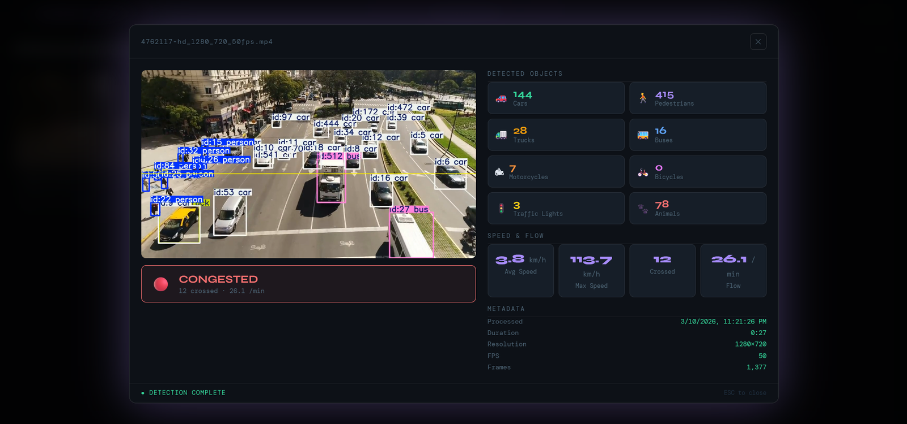

# Traffic_Detection_with_YOLO

<p align="center">
  
  
  
  
  
  
</p>

**NeuralVision Pro (PERCEPT)** is an autonomous perception and traffic analysis engine powered by YOLOv8, ByteTrack multi-object tracking, Flask, and React. Detect, track, and count vehicles, pedestrians, and cyclists from dashcam footage and traffic camera feeds in real time.

---

## 📸 Hero Preview

<p align="center">
  
</p>

## 🖼️ UI Snapshot Gallery

<p align="center">
  
  
</p>

---

## ✨ Features

- 🚗 **Multi-Class Vehicle Detection** - Accurately recognizes cars, buses, trucks, motorcycles, cyclists, and pedestrians with YOLOv8.
- 🎯 **ByteTrack Multi-Object Tracking** - Assigns persistent track IDs and maintains trajectory history across frames.
- 📊 **Bidirectional Traffic Counting** - Virtual trigger lines count inbound and outbound traffic flow automatically.
- ⚡ **Auto-Detect Hardware Acceleration** - Auto-selects NVIDIA CUDA GPU, Apple Silicon MPS, or multi-core CPU.
- 🎞️ **Frame-by-Frame Video Ingestion** - Upload dashcam MP4/AVI videos with automated H.264 re-encoding and playback.
- 🖥️ **Interactive Web Interface** - Modern React frontend with live progress telemetry and side-by-side video players.

---

## 🛠️ Tech Stack

- **Computer Vision & AI**: Ultralytics YOLOv8, ByteTrack, OpenCV, PyTorch
- **Backend API**: Flask, Flask-CORS, ImageIO-FFmpeg
- **Frontend Dashboard**: React, Vite, Tailwind CSS, Axios
- **Notebook & Research**: Jupyter Notebook (`vehicles-detection-and-counting.ipynb`)

---

## 🚀 Quick Start

### 1. Clone the repository
```bash
git clone https://github.com/soorajstudio/Traffic_Detection_with_YOLO.git
cd Traffic_Detection_with_YOLO
```

### 2. Start Backend (Flask)
```bash
pip install ultralytics torch torchvision opencv-python flask flask-cors
python app.py
```

### 3. Start Frontend (React)
```bash
cd frontend
npm install
npm run dev
```

Open [http://localhost:5173](http://localhost:5173) in your browser.

---

## 📄 License

This project is licensed under the MIT License — see the [LICENSE](LICENSE) file for details.

Developed with ❤️ by [Sooraj Studio](https://github.com/soorajstudio).
