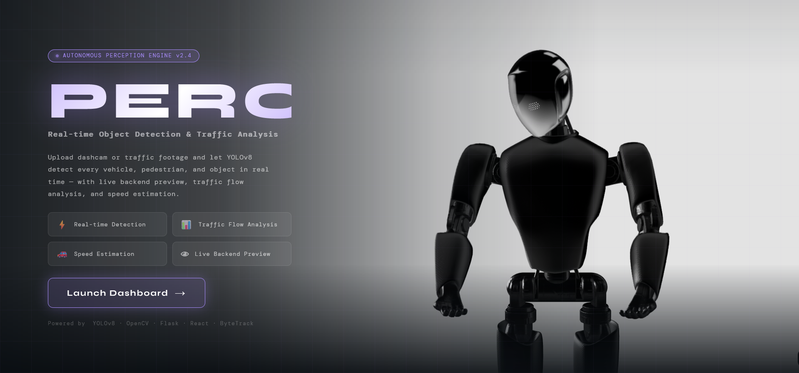
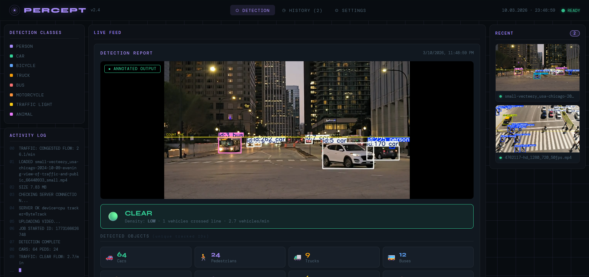

# NeuralVision Pro 🚀
An autonomous perception engine using **YOLOv8**, **Flask**, and **React**.

## 🖥️ Interface Preview

---

## 🛠️ How it Works

### 1. Upload & Scan
When you upload a dashcam video, the NeuralVision engine begins frame-by-frame analysis.

### 2. Real-Time Detection
Our custom YOLOv8 filter identifies vehicles, pedestrians, and animals, returning a processed loop.

## 🚀 Setup Instructions
1. **Backend:** Run `python app.py`
2. **Frontend:** Run `npm run dev`